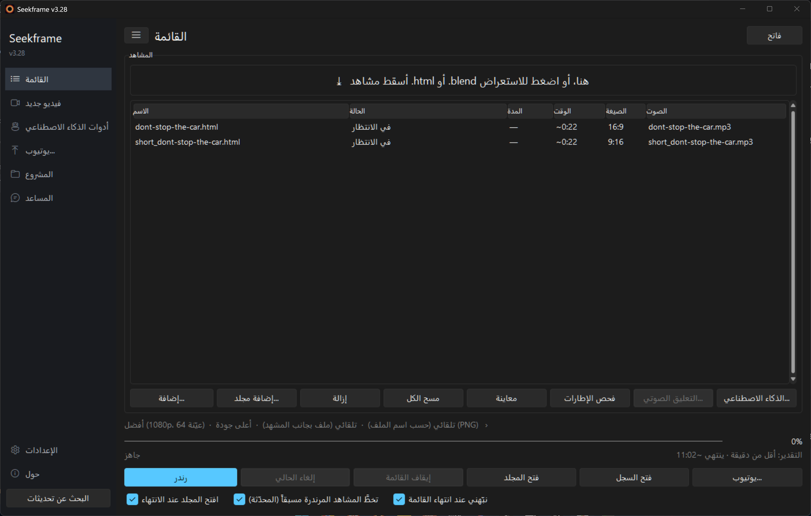
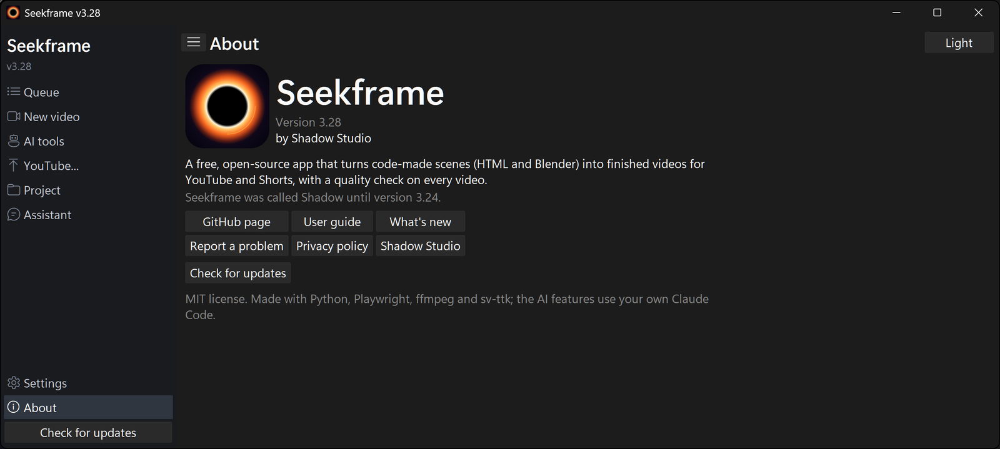
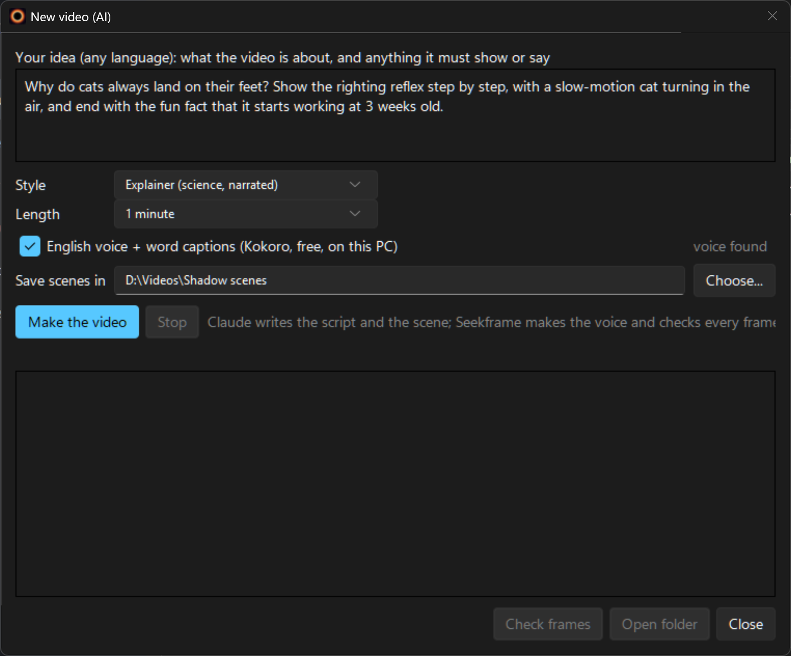
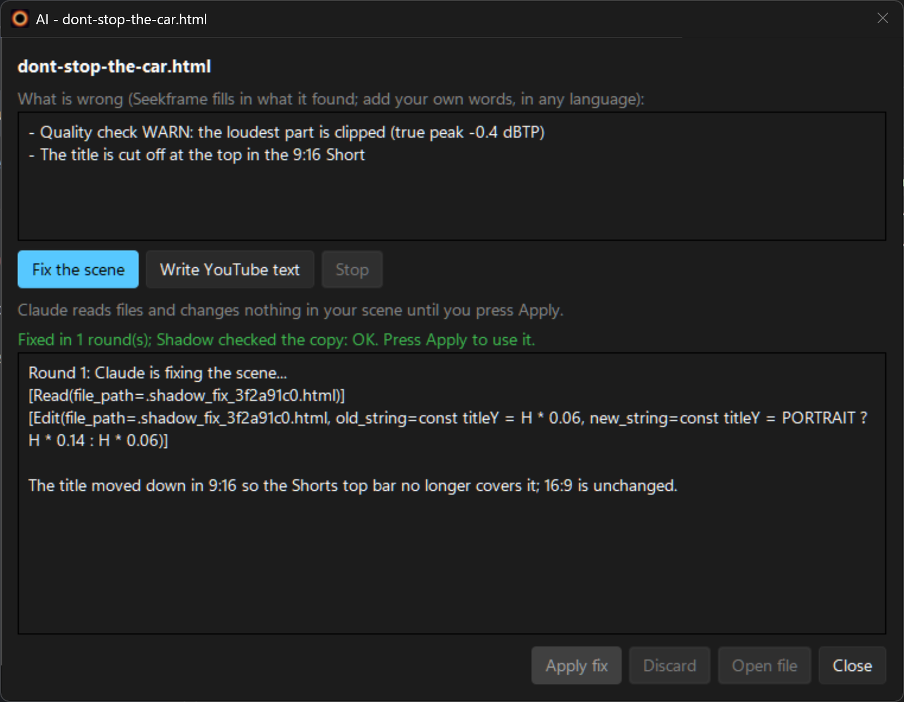

# Seekframe user guide

Everything in the Seekframe window, what each setting does, where your files go, and what to do when something goes wrong.
New to Seekframe? Start with [Quick start](../README.md#quick-start), then come back here.

- [Install, update, uninstall](#install-update-uninstall)
- [The window](#the-window)
- [The scenes table](#the-scenes-table)
- [Buttons under the table](#buttons-under-the-table)
- [Options](#options)
- [Rendering](#rendering)
- [What you get](#what-you-get)
- [The quality check (QC)](#the-quality-check-qc)
- [Sound](#sound)
- [Narration and captions](#narration-and-captions)
- [Shorts (9:16)](#shorts-916)
- [Blender scenes](#blender-scenes)
- [Assistant panel and Claude](#assistant-panel-and-claude)
- [Command line](#command-line)
- [Settings, logs and privacy](#settings-logs-and-privacy)
- [Troubleshooting](#troubleshooting)

---

## Install, update, uninstall

**Install.** Download `Seekframe-<version>-Setup.exe` from [Releases](../../../releases/latest) and run it. It installs for
your Windows user only (no admin), to `%LOCALAPPDATA%\Seekframe`, with a Desktop and a Start menu shortcut. The installer is
in English or Arabic. Windows SmartScreen may warn because the installer is not code-signed: choose *More info* → *Run anyway*
(the release page lists the file's SHA-256 so you can check it).

**What Seekframe needs.** Google Chrome (Seekframe draws your scenes in it; without Chrome it uses Microsoft Edge, which comes
with Windows) and ffmpeg (encoding and the quality check). If one is missing, the installer offers to install it with winget, and the top bar in Seekframe shows it in red with an
*Install missing* button. Blender is optional and only needed for `.blend` scenes.

**Update.** About 2 seconds after Seekframe opens it asks GitHub for the latest release. When a newer one exists, a bar
appears under the page title and Windows shows a notification (once per version): press **Update now**, confirm, and Seekframe downloads the installer (checking its size
and SHA-256), installs it and opens again by itself. You can also press **Check for updates** on the About page at any time. Your settings,
logs and videos are kept. The update waits while a render is running.

**Uninstall.** Windows *Settings → Apps → Installed apps → Seekframe → Uninstall*. Your settings file and log
(see [Settings, logs and privacy](#settings-logs-and-privacy)) and your videos are left in place; delete them by hand if you want.

## Language

The list at the top of the window (next to *Light / Dark*) sets the language of Seekframe's window: English, العربية, 中文,
हिन्दी, Español, Français, Português, Русский, Bahasa Indonesia, Deutsch, 日本語, or **Auto (Windows)**, which uses your
Windows display language when Seekframe has it and English otherwise. Seekframe asks to restart and opens in the new language.
Only what you read changes: settings, projects, file names and the log stay the same in every language.



## The window

The window has a **sidebar** on the left and the open page on the right. The ☰ button at the top hides or shows the
sidebar (Seekframe remembers it).

- **Queue**: your scenes, the render options (Quality, Format, Sound, Capture, Blender), the Render buttons and the progress.
- **New video**, **AI tools**, **YouTube...**, **Project** and **Assistant** open those windows or menus.
- **Settings** (bottom):
  - *Save videos to*: the folder (buttons for This PC, OneDrive, Google Drive, Dropbox, iCloud Drive, Box and
    *Network drive (NAS)...*; one that is not found asks for its folder), the Folder rule, and **Check access** (can Seekframe write there, how much space is free).
  - *Setup*: Chrome, ffmpeg, Playwright, Blender, with *Install missing* and *Self-test*.
  - *Cloud accounts*: sign in to Google Drive, OneDrive, Dropbox, Box or pCloud in your browser (no cloud app needed;
    it uses rclone, which *Get rclone* downloads for you). Then **Cloud...** in the Queue adds files from there (a scene
    brings its whole folder), and *Also upload finished videos to* sends each finished video to `Seekframe/...` there.
  - *AI connections*: a tick box for every AI app on this PC (Claude Code, Claude Desktop, Cursor, VS Code Copilot,
    Windsurf / Devin, Gemini CLI, Codex). Tick one and Seekframe sets itself up in that app (restart the app if it is
    open); green = connected, *In use now* = it is running Seekframe. Windows shows a notification when one connects.
    Below: which AI does Seekframe's own AI buttons (Claude Code or Gemini CLI); the Assistant chat always uses Claude Code.
  - *AI account*: your Claude subscription (default), or your own Anthropic API key (paid per use; stored encrypted).
  - *Language*.
- **About** (bottom, picture below): the version, Shadow Studio, and links to the GitHub page, this guide, what's new, the privacy
  policy and *Report a problem*.
- **Check for updates** is on the About page; it becomes *Update to vX.Y* when a new version is out (and a bar with
  *Update now* appears under the page title).



## The scenes table

Drop `.html` or `.blend` files (or whole folders) onto the drop area, or click it to browse. Each scene is one row:

| Column | Meaning |
|---|---|
| **Name** | The scene file. `[voice]` = narration attached, `[voice embedded]` = narration already inside the file (never added twice). |
| **Status** | `Queued`, the current step (`Loading scene`, `Rendering sound`, `Frames 120/900`, `Encoding MP4`), then `Done` (+ `· QC OK / Warn / Fail`, `· thumb`), `Done (silent)`, `Skipped (up to date)`, `Skipped (outdated, no 9:16)`, `Cancelled` or `Error`. |
| **Time** | Before rendering: an estimate. While rendering: the time left. After: how long it took. |
| **Duration** | The video length once it is rendered. |
| **Format** | 16:9 or 9:16 for this row (see [Shorts](#shorts-916)). |
| **Audio** | What sound this row will use: a song file name, narration, the scene's own sound, or silent. |

Under the progress bar, Seekframe shows the queue estimate, e.g. *about 12 min · done ~15:40*. It starts from a rough guess
(frames × measured speed) and corrects itself with the real speed after the first frames.

You can add and remove rows while a batch renders: new rows render after the ones before them. Double-click a row to
preview it, and press Delete to remove it.

## Buttons under the table

| Button | What it does |
|---|---|
| **Add...** | Pick scene files. |
| **Add folder...** | Adds every `.html` / `.blend` in a folder. If scenes are only in subfolders, Seekframe asks before adding them. Dropping a folder does the same. |
| **Remove** / **Clear** | Remove the selected rows / all rows (a running render is stopped first). |
| **Preview** | Opens the scene in your browser (a `.blend` opens in Blender). |
| **Check frames** | A quick look before a long render: a contact sheet of frames in 16:9 and 9:16, page errors, and whether the scene draws the same frame twice for the same time. Takes seconds. Results in a small window; the sheet is saved as `<scene>.check.jpg` next to the scene. |
| **Narration...** | Attach a voice and word timings to the selected scene (see [Narration](#narration-and-captions)). |

## Options

| Option | Choices |
|---|---|
| **Quality** | *Best (1080p, 64 samples)* - the default for uploads. *Good (1080p, 24 samples)* - faster, slightly less smooth effects. *Draft (fast, 720p)* - quick looks only. *1440p* and *4K* - sharper uploads (a 1440p or 4K upload is streamed by YouTube with a better codec, also at 1080p); a 4K render takes about 3x as long as 1080p and the file is about 3x bigger. "Samples" is passed to the scene; scenes use it for antialiasing and effects. |
| **Format** | *16:9 (YouTube)*, *9:16 (Shorts)*, or *Auto (by file name)* - decided per file (see [Shorts](#shorts-916)). |
| **Sound** | *Generated (built into the scene)*, *None (silent)*, *External file...*, *Auto (file next to scene)* (see [Sound](#sound)). |
| **Capture** | *Best quality (PNG)* - lossless frames, the default. *Fast (JPEG, ~1.2x faster)* - a very slightly softer picture and a ~1.2x larger file (measured end to end: 1080p 22 -> 18 ms per frame). Since 3.15 PNG is fast too, so Fast is mostly for drafts. |
| **Blender** | For `.blend` files only: *Scene setting*, *Eevee*, *Cycles (GPU)*, *Workbench (fast)*. |
| **Save to** | The folder where every scene gets its own subfolder (see [What you get](#what-you-get)). |
| **Open folder when done** | Opens the output folder after the batch. |
| **Skip scenes already rendered (up to date)** | On by default. A scene whose video is newer than the scene and its song / voice files (and has the right size) is not rendered again; the row says *Skipped (up to date)*. Change the scene and it renders again. Note: switching only between Good and Best (same size) is not detected - turn the option off for that. |
| **Notify me when the queue ends** | A Windows notification with how many videos were done or failed; click it to open the folder. Not shown when you cancel or when everything was skipped. |

## Rendering

**Render** starts the queue from the top. **Cancel current** stops only the scene being rendered (the queue continues with
the next one). **Stop queue** stops everything. A cancelled or failed render never leaves a half-written video: Seekframe
writes `<name>.part.mp4` and only renames it when everything succeeded.

How it works: Seekframe serves the scene's folder on a local address, opens it in your installed Chrome or Edge (in the
background), renders the sound first, then lets several copies of the scene draw different frames at the same time
(`seek(t)`, about 4x faster than one copy) and pipes the frames, in order, straight into ffmpeg, which encodes while the
next frames are drawn. Because `seek(t)` must draw exactly the moment `t`, the copies give the same video as one would;
a scene that keeps a little state between frames can differ by an invisible amount. `SHADOW_CAPTURE_WORKERS=1` (an
environment variable) renders with one copy, exactly like Seekframe 3.14 and older. Nothing depends on how fast your PC is - a slow PC takes longer and makes
the same video.

## What you get

For a scene `C:\Scenes\ocean.html` and *Save to* `D:\Videos`:

```
D:\Videos\ocean\
  ocean.mp4            1920x1080, 30 fps, H.264 (x264 CRF 16) + AAC 192 kbps
  ocean.qc.txt         the quality report
  ocean_shorts.mp4     if it was also rendered 9:16 (1080x1920), with ocean_shorts.qc.txt
  ocean.srt            subtitles, if the scene was narrated
  ocean_thumb.jpg      1280x720 thumbnail, if the scene sets window.THUMBNAIL_T
  ocean_<time>.log     only if the render failed: what went wrong
```

A Short made from its own scene file (`short_ocean.html`, `ocean-short.html`...) is saved in the same folder as the video:
`ocean\ocean_shorts.mp4`.

**Folder** (under Save to) picks the main folder: *Auto (Music / Video)* decides per scene - a scene that plays a song file
next to it goes to `D:\Videos\Music\ocean\`, everything else to `D:\Videos\Video\ocean\`. Choose *Music*, *Video*, your
own folder (**New folder...**), or *None* to put scene folders straight into Save to. A scene can also name its folder in
its `<head>`: `<meta name="shadow-folder" content="Music">` (Auto follows it; nested names like `Music/2026` work too).

Existing files are never overwritten: a second render becomes `ocean_2.mp4`, `ocean_3.mp4`... (unless *Skip scenes
already rendered* skips it). A folder created for a scene that was cancelled before anything was written is removed again.

## The quality check (QC)

After every render Seekframe measures the video and writes `<name>.qc.txt`. The row shows **QC OK**, **QC Warn** or **QC Fail**;
the report lists every reason.

| Check | Limit |
|---|---|
| Resolution | must match the chosen quality and format |
| Duration | Warn when it differs from the scene's length by more than 0.3 s, Fail above 1 s |
| Audio | an audio track must exist (unless the video is silent on purpose) |
| Loudness | -17 to -13 LUFS (Seekframe aims for -15) |
| True peak | at most -1 dBTP |
| Black frames | Warn for black longer than 0.5 s (the first half second is ignored, for fade-ins) |
| Frozen picture | Warn when the picture does not change for more than 5 s |

QC only adds information: it never changes or deletes your video.

## Sound

| Mode | What it uses |
|---|---|
| **Generated (built into the scene)** | The sound the scene makes itself (its `STYLE_SOUND` score). A scene without one renders silent and the row says *Done (silent)*. |
| **None (silent)** | No audio track. |
| **External file...** | One song or voice file you pick, for every scene in the batch. |
| **Auto (file next to scene)** | Each scene uses its own file with the same name next to it: `<scene>.wav`, `.mp3`, `.m4a`, `.flac`, `.ogg` or `.aac` (first one found). So one batch can render several songs. No file → the scene's own sound + a warning. `<scene>.wav` together with `<scene>.words.json` counts as narration, not a song. |

Songs are loudness-matched to about **-14 LUFS** (YouTube's own playback level). That covers a song file used as the sound,
or a scene in the Music folder. Narration and the scene's own sound are matched to **-15 LUFS**. A scene can choose its own
level with `<meta name="shadow-lufs" content="-16">` (-24 to -9). The true peak always stays under -1 dBTP. All of this is
measured *after* the AAC encode, so loud masters pass the quality check. Seekframe only ever turns a track down, never up.

## Projects

**Project > Save project as...** saves the list (scenes in order, each row's narration) and the options (Quality, Format,
Sound, Capture, Blender, Folder, Save to, Skip) in a `.shadow` file. **Project > Open project...**, dropping the file on
Seekframe, or `Seekframe.exe episode.shadow` opens it again; with scenes already in the list Seekframe asks whether to replace or
add. Paths are stored relative to the project file, so keep it in the episode folder and you can move or copy the folder.

## Narration and captions

Put two files next to the scene with the same name: `<scene>.wav` (the voice) and `<scene>.words.json` (word timings,
`{"words": [{"w": "Hello", "s": 0.32, "e": 0.61}, ...]}`). Seekframe attaches them by itself and marks the row `[voice]`.
Or select a row and press **Narration...** to pick the files, the caption style (pop or karaoke) and whether to show
word captions.

- The voice is mixed into the scene's own sound, so narrated scenes always render with *Generated* sound (Seekframe tells you
  if another mode was selected).
- Word captions are drawn on 2D canvas scenes. WebGL / three.js scenes get the voice only (Seekframe warns).
- Every narrated video also gets a `.srt` subtitle file from the same word timings - ready to upload to YouTube.
- Need word timings for a voice recording? `python tools\narrate\make_words.py voice.wav script.txt` (free, offline,
  faster-whisper) writes `voice.words.json` and `voice.srt`; with the script, your exact words get the voice's timings.

## Shorts (9:16)

With **Format = Auto (by file name)**, a scene renders 9:16 when its file name starts with `short_` or ends with
`-short`, `_short` or ` short` (also `...shorts`, any case) - for example `short_ocean.html` or `ocean-short.html`.
Everything else renders 16:9. So one queue can make the video and its Short together; the Short is saved as
`<scene>_shorts.mp4` in the same folder.

A scene must read the `h` URL parameter and lay itself out for a tall frame to support 9:16. Before rendering 9:16,
Seekframe checks each scene and asks what to do with scenes that do not (they would look like a squeezed 16:9).

## Smart Seekframe (AI)

Seekframe can hand work to Claude through **your Claude subscription** and the installed Claude Code (the same as the
Assistant panel; it refuses API keys, so nothing is billed per use). Claude can read files, and it can change only the
one file a job is about. It cannot run programs or open web pages.

 

**New video (AI)...** (top bar)
1. Write the idea in any language, and pick a **Style** and a **Length**.
2. Keep **English voice + word captions** on if it is available (it needs Kokoro installed on this PC; without it the video
   gets a music bed and titles instead).
3. Press **Make the video**. Claude writes the narration, Seekframe makes the voice and the word timings, Claude builds the
   scene to follow the words, and Seekframe checks it (scene rules + frames in 16:9 and 9:16). Anything wrong goes back to
   Claude, up to three times. A 30-second video took about 8 minutes in a test.
4. The scene is added to the queue with its voice attached. Check frames, then Render.
Each idea gets its own folder under *Save scenes in* (default `Videos\Seekframe scenes`); nothing is overwritten.

**AI...** (under the table, one row selected)
- **Fix the scene**: the box starts with what Seekframe saw go wrong for that row (a failed render and its log, a quality
  check warning, Check frames problems). Add your own words, e.g. *the title is cut off in the Short*. Claude fixes a copy,
  Seekframe checks it, and you see the changes line by line. **Apply** puts the fix in place and keeps the original in
  `.shadow_backup` next to the scene; **Discard** throws the copy away. *Check frames* has a **Fix with AI...** button too.
- **Write YouTube text** (after the row was rendered): Claude looks at frames of the video and writes `metadata.txt` next
  to it, which *YouTube...* uses. If one is there already, Seekframe asks whether to replace it (the old one is kept) or write
  `metadata_2.txt`.

## A finished video + a song

Seekframe can also join a video you already have (.mp4, .mov, .m4v, .webm, .mkv) with a song. Put the song next to it with
the same name (`dance.mp4` + `dance.mp3`), or pick it with Sound = *External file...*, and add the video like a scene.

Seekframe looks at the video (how much it moves every half second, hard cuts, its strongest moment, where it could loop) and
at the song (beats, chorus), then:
- a 9:16 clip, or any clip with a song of 60 s or less: takes the **chorus** of the song, starting on a beat so the
  video's strongest moment lands on the chorus, with a short fade at the end;
- a short 16:9 clip with a longer song: **loops** the video to the song's length, with a soft crossfade at the seam;
- a video longer than the song: **cuts** it to the song and fades out.

The video keeps its own size and shape (Format is ignored for it), the song is set to -14 LUFS like every song render,
and the result goes to the *Music* folder with a QC report and a thumbnail at the strongest moment. *Check frames* on a
video row shows a contact sheet and the plan (where the song starts, where it loops) before you render.
From Claude, `shadow_video_look` and `shadow_video_song` do the same and let Claude change the start or loop point.

## Blender scenes

`.blend` files go in the same queue and get the same sound modes, Shorts, QC and folders. Seekframe runs your installed
Blender in the background (no window) with the engine you pick under **Blender**. For 9:16, add a camera named like
`Camera 9x16`; without it Seekframe crops the middle of the 16:9 camera and warns. Details: [BLENDER.md](BLENDER.md).

## Upload to YouTube

**YouTube...** (next to *Open log*) uploads the videos you just rendered to one of your channels, with the title,
description, tags and *Made for Kids* from a `metadata.txt` next to the video or the scene. `AI: yes` sets YouTube's
AI-content label, the thumbnail Seekframe saved (or `THUMBNAIL:`) is set on the video, and a `PUBLISH:` date and time
schedules it. A video added with *Add video...* uses the metadata.txt of its scene in the list; the file is read again
when you press Upload, selecting a row shows which one it uses, and Seekframe asks before uploading a video without one.
Sign in once per channel in your browser; uploads are Private by default. It needs a free one-time Google Cloud setup, and until that project passes
YouTube's API audit, uploads stay Private: [YOUTUBE.md](YOUTUBE.md).

## Assistant panel and Claude

Press **Assistant** to open a chat on the right. Ask in plain words - "render this folder and check the quality",
"check the frames of ocean.html" - and watch Claude's steps and answer as they arrive. **Stop** interrupts, **New chat**
starts over, **Folder...** chooses the folder Claude may read.

It uses **your own Claude subscription through the installed Claude Code** (no API key, no extra cost). Claude can only
read files in that folder and use Seekframe's tools; stopping a render or uploading to YouTube needs your **Allow once**. Setup and the exact
permissions: [ASSISTANT.md](ASSISTANT.md).

The same tools are available to Claude Code, Claude Desktop and other AI apps that support MCP (Cursor, VS Code,
Windsurf, Gemini CLI): [MCP.md](MCP.md).

## Command line

```
Seekframe.exe --render scene.html out.mp4 [--vertical] [--preset draft|good|best|1440p|4k] [--silent] [--fast] [--engine ...]
Seekframe.exe --check scene.html [--only 16:9|9:16] [--times ...] [--out sheet.jpg] [--engine ...]
Seekframe.exe --selftest
Seekframe.exe project.shadow
```

`--render` writes exactly the path you give (no scene folder) plus its QC report; the exit code is 0 when the video has
the expected size. `--fast` = Fast (JPEG) capture. `--engine` (for `.blend`): `scene`, `eevee`, `cycles` or `workbench`.
`--check` makes the contact sheet and purity check without rendering. `--selftest` renders the built-in test video and
prints each step (exit code 0 = all fine). A `.shadow` file opens the window with that project.

## Settings, logs and privacy

- Settings: `%USERPROFILE%\.shadow_renderer.json` (theme, Save to, options).
- Log: `%USERPROFILE%\shadow.log` - press **Open log**. A failed render also leaves `<scene>_<time>.log` in its folder.
- **What goes online:** the update check (GitHub's public releases API, no account), whatever your scenes load themselves
  (for example three.js from a CDN), and - only when you use the Assistant - your messages to Claude through Claude Code.
  Nothing else is sent anywhere: no account, no analytics.

## Troubleshooting

| Problem | What to do |
|---|---|
| Not sure the setup works | Press **Self-test** (setup bar, or `Seekframe.exe --selftest`): it renders a 2-second test video with sound and names the step that fails. |
| Windows says "Windows protected your PC" | The installer is not code-signed. *More info* → *Run anyway*. |
| "ffmpeg (missing)" right after installing it | Sign out and in once (or restart) so Windows refreshes the PATH, then *Re-check*. |
| A row says **Error** | Read `<scene>_<time>.log` in its folder (or *Open log*). The first line of the error is also shown in the message box. |
| "These scenes miss something Seekframe needs" (before rendering) | Seekframe read the scene and found no `window.__ready`, `window.seek(t)`, `window.DURATION` or `<canvas id="c">` (see [Make a scene](../README.md#make-a-scene)). **No** skips those scenes, **Yes** tries anyway (the check only reads the text, so a scene built in an unusual way can still work). |
| "The scene cannot render: ..." | The scene loaded, but the part named in the message is missing or wrong (for example `DURATION` is text, not a number). |
| "The scene did not load" | The scene never set `window.__ready = true` in time, or has a script error (shown in the message). Open it with **Preview** and look at the browser console, or run **Check frames**. |
| "ffmpeg failed: ..." | The message shows ffmpeg's last 3 lines. A full disk or a broken song file are the usual causes. |
| The video jumps or flickers | The scene is not a pure function of time (a real-time loop or `Math.random`). **Check frames** reports this. |
| 9:16 looks squeezed | The scene does not read `h` - see [Shorts](#shorts-916). |
| QC Warn: true peak / loudness | Usually a very loud master; Seekframe already turns it down. Re-render with the current version; if it stays, open an issue with the `.qc.txt`. |
| The update did not install | Close Seekframe and run the new `Seekframe-<version>-Setup.exe` from Releases by hand. Setup logs are in `%TEMP%\Setup Log *.txt`. |
| Still stuck | [Open an issue](../../../issues/new/choose) with the version, steps and the log. |

Writing scenes: [Make a scene](../README.md#make-a-scene) and the minimal example
[`tests/fixtures/webgl_min.html`](../tests/fixtures/webgl_min.html).
